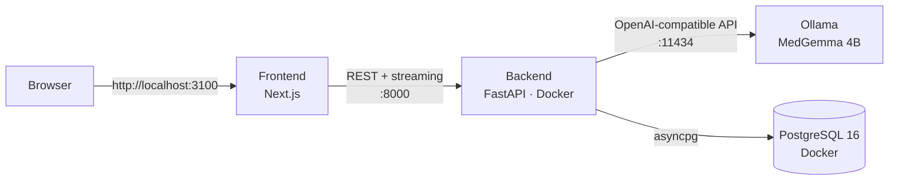

# Smarter Health AI

A private, self-hosted AI health assistant powered by **Google MedGemma**. It answers health questions, reads medical images, and suggests specialist doctors from your own directory. Everything runs on your machine.

> ⚠️ **Medical disclaimer.** This is a developer project. MedGemma can make mistakes and is **not** a substitute for professional medical advice, diagnosis, or treatment. Validate it properly before you use it with real patients.
>
> The 200 doctors in `backend/data/doctors.sample.json` are **fictional sample data** for development.

## Features

- 💬 **Chat** with MedGemma 4B, with answers streamed word by word.
- 🩻 **Medical image analysis**: X-rays, skin photos and scans.
- 🚨 **Emergency detection**: red-flag symptoms trigger a "call 112 / 911" warning, independent of the model.
- 🩺 **Specialist suggestions**:
  - MedGemma triages the conversation into specialties.
  - Doctors from PostgreSQL are ranked by specialty, conditions treated, rating, experience, city, language and availability.
- 🔒 **Private**: the model runs locally through Ollama, and no data leaves your machine.
- 🌗 A Next.js chat interface with chat history, light and dark themes, and a mobile layout.

## Architecture



| Part | Tech | Runs |
|---|---|---|
| Frontend | Next.js 16, React 19, TypeScript | `npm run dev` on port **3100** |
| Backend | FastAPI, Python 3.11, asyncpg, Alembic | **Docker** on port **8000** |
| Database | PostgreSQL 16 | **Docker** (host port 5433) |
| AI model | MedGemma 4B through Ollama | Natively on your machine, port **11434** |

## Project structure

```
smarter-health/
├── docker-compose.yml        # backend + PostgreSQL
├── .env.example              # Docker settings (copy to .env)
├── backend/
│   ├── Dockerfile
│   ├── docker-entrypoint.sh  # migrations → seed → start API
│   ├── app/
│   │   ├── main.py           # API routes
│   │   ├── medgemma_client.py# talks to the model server
│   │   ├── triage.py         # MedGemma → specialties
│   │   ├── doctors.py        # doctor model + ranking
│   │   ├── db.py             # PostgreSQL queries
│   │   ├── models.py         # table definitions (for Alembic)
│   │   ├── prompts.py        # system & triage prompts
│   │   └── safety.py         # emergency detection
│   ├── alembic/              # database migrations
│   ├── scripts/              # import_doctors.py, sample-data generator
│   ├── data/                 # doctors.sample.json (fictional)
│   └── tests/
└── frontend/
    └── src/
        ├── app/              # layout, page, global styles
        ├── components/       # ChatApp, Sidebar, Composer, DoctorSuggestions…
        └── lib/              # API client, types, storage
```

---

# 🚀 Quick start

## Step 1: Install the requirements

| Tool | Why | Install (macOS) |
|---|---|---|
| **Docker Desktop** | runs the backend and the database | https://www.docker.com/products/docker-desktop |
| **Ollama** | runs the MedGemma model | `brew install ollama` or https://ollama.com/download |
| **Node.js 20+** | runs the frontend | `brew install node` |
| **Git** | clones the repo | `brew install git` |

**Hardware:** at least 16 GB RAM is recommended, and about 6 GB of free disk for the model. Apple Silicon or an NVIDIA GPU makes answers much faster.

## Step 2: Clone the repository

```bash
git clone https://github.com/<your-username>/<your-repo>.git
cd <your-repo>
```

## Step 3: Start Ollama and download MedGemma

```bash
# Start Ollama in the background (or just open the Ollama app)
brew services start ollama          # macOS; on Linux: `ollama serve &`

# Download MedGemma 4B (~3.3 GB, one time)
ollama pull hf.co/unsloth/medgemma-4b-it-GGUF:Q4_K_M

# Give it a short name, which the backend expects
ollama cp hf.co/unsloth/medgemma-4b-it-GGUF:Q4_K_M medgemma

# Test it
ollama run medgemma "What is a normal resting heart rate?"
```

If the download stops partway, run the same `ollama pull` command again. It resumes where it left off.

## Step 4: Start the backend (Docker)

```bash
cp .env.example .env               # optional: edit passwords / settings
docker compose up -d --build
```

The first start:
1. Builds the backend image.
2. Starts PostgreSQL.
3. Runs the database migrations.
4. Loads the 200 sample doctors.
5. Starts the API.

Check that it's healthy:

```bash
docker compose ps                  # both services should be "healthy"
curl http://localhost:8000/api/health
```

All values should be `true`:

```json
{"status":"ok","model":"medgemma","model_server_reachable":true,"model_available":true,"database_reachable":true}
```

📖 Interactive API docs: **http://localhost:8000/docs**

## Step 5: Start the frontend

Open a **new terminal**:

```bash
cd frontend
cp .env.example .env.local         # points the app at http://localhost:8000
npm install
npm run dev
```

Open **http://localhost:3100** 🎉

## Step 6: Try it

1. Click a suggestion card, or type *"I have had a headache and mild fever for 2 days"*.
2. Under the answer, click **🩺 Find a specialist** to see matching doctors.
3. Filter by city, language or online consultation.
4. Use 📎 to attach a medical image.

---

## Everyday commands

| Task | Command |
|---|---|
| Start the backend | `docker compose up -d` |
| Stop the backend | `docker compose down` |
| Backend logs | `docker compose logs -f backend` |
| Rebuild after code changes | `docker compose up -d --build` |
| Start the frontend | `cd frontend && npm run dev` |
| Stop the frontend | `Ctrl + C` |
| **Reset the database** (deletes all data) | `docker compose down -v` |

---

## Use your own doctors

1. Create a CSV file. List fields are separated by `;`:

```csv
id,name,specialty,sub_specialties,conditions,qualifications,experience_years,languages,city,hospital,rating,review_count,fee,currency,available_days,teleconsult
D001,Dr. Jane Doe,Cardiology,Interventional Cardiology,chest pain;hypertension;arrhythmia,"MBBS, MD, DM",15,English;Hindi,Pune,City Hospital,4.6,120,800,INR,Mon;Wed;Fri,yes
```

Only `id`, `name` and `specialty` are required. MedGemma only suggests specialties that exist in your data.

2. Import it into the running backend:

```bash
docker compose cp my_doctors.csv backend:/tmp/my_doctors.csv
docker compose exec backend python scripts/import_doctors.py /tmp/my_doctors.csv --replace
```

`--replace` deactivates doctors that aren't in your file, such as the sample doctors. Rows are matched by `id`, so re-importing is safe.

3. To stop loading the sample data, set `SEED_SAMPLE_DOCTORS=false` in `.env`.

---

## Configuration

Set these in the root `.env` file, used by Docker:

| Variable | Default | Purpose |
|---|---|---|
| `LLM_BASE_URL` | `http://host.docker.internal:11434/v1` | Model server. Any OpenAI-compatible API works (Ollama, vLLM, Hugging Face Endpoints). |
| `LLM_MODEL` | `medgemma` | Model name on that server |
| `LLM_API_KEY` | – | Key for a cloud model server |
| `POSTGRES_PASSWORD` | `change-me-local-only` | Password for the bundled PostgreSQL. **Change it.** |
| `DATABASE_URL` | bundled database | Use an external PostgreSQL instead |
| `CORS_ORIGINS` | `http://localhost:3100,…` | Frontend addresses allowed to call the API |
| `APP_API_KEY` | – | If set, every request needs the header `X-API-Key` |
| `ADMIN_API_KEY` | – | Enables `PUT/DELETE /api/doctors/{id}` with the header `X-Admin-Key` |
| `SEED_SAMPLE_DOCTORS` | `true` | Load the sample doctors into an empty database |
| `API_PORT` / `DB_PORT` | `8000` / `5433` | Ports on your machine |

**Using a cloud model instead of Ollama**, for example a Hugging Face Inference Endpoint:

```env
LLM_BASE_URL=https://<your-endpoint>.endpoints.huggingface.cloud/v1
LLM_MODEL=tgi
LLM_API_KEY=hf_xxx
```

**Using an external PostgreSQL**, for example one on minikube:

```bash
kubectl -n <namespace> port-forward svc/<postgres-service> 15432:5432
```

```env
DATABASE_URL=postgresql://<user>:<password>@host.docker.internal:15432/<database>
```

---

## API overview

| Method | Endpoint | Description |
|---|---|---|
| GET | `/api/health` | Status of the API, the model and the database |
| POST | `/api/chat` | Full reply at once |
| POST | `/api/chat/stream` | Streaming reply (Server-Sent Events: `meta` → `delta`… → `done`) |
| POST | `/api/analyze-image` | Upload one image (multipart) for analysis |
| POST | `/api/recommend-doctors` | Suggest doctors for a conversation (with city, language and online filters) |
| GET | `/api/doctors` | Search doctors (`?specialty=&city=&q=`) |
| GET | `/api/doctors/meta` | Specialties, cities and languages, for the filters |
| PUT / DELETE | `/api/doctors/{id}` | Create or update, or deactivate a doctor (needs `X-Admin-Key`) |

Example:

```bash
curl http://localhost:8000/api/chat -H 'Content-Type: application/json' \
  -d '{"messages":[{"role":"user","content":"What is HbA1c?"}]}'
```

---

## Database migrations (Alembic)

Migrations run automatically when the backend container starts. To change the schema:

```bash
cd backend
# 1. edit app/models.py
# 2. create a migration (needs a local Python env, see "Run the backend without Docker")
.venv/bin/alembic revision --autogenerate -m "add phone to doctors"
# 3. review the file in alembic/versions/, then rebuild:
docker compose up -d --build
```

---

## Run the backend without Docker (optional)

```bash
cd backend
uv venv --python 3.11 .venv            # or: python3.11 -m venv .venv
uv pip install --python .venv/bin/python -r requirements.txt -r requirements-dev.txt
cp .env.example .env                   # set DATABASE_URL to your PostgreSQL
.venv/bin/alembic upgrade head
.venv/bin/python scripts/import_doctors.py data/doctors.sample.json
.venv/bin/uvicorn app.main:app --reload --port 8000
```

Run the tests:

```bash
.venv/bin/python -m pytest -q
```

---

## Troubleshooting

| Problem | Fix |
|---|---|
| `model_server_reachable: false` | Ollama isn't running. Run `brew services start ollama` (or open the Ollama app), then check `curl http://localhost:11434/api/version`. |
| `model_available: false` | The `medgemma` name is missing. Run the `ollama cp …` command from Step 3, then check `ollama list`. |
| `database_reachable: false` | Check `docker compose ps` and `docker compose logs db`. |
| "Cannot reach the Smarter Health API" in the app | The backend isn't running on port 8000. Check `docker compose ps`. |
| CORS error in the browser console | Add the frontend address to `CORS_ORIGINS` in `.env`, then run `docker compose up -d`. |
| `port is already allocated` | Change `API_PORT` / `DB_PORT` in `.env`, or stop the other app. For the frontend: `npm run dev -- -p 3200`. If you change the frontend port, add it to `CORS_ORIGINS`. |
| Slow answers | That's normal on a CPU. Answers are much faster on Apple Silicon or an NVIDIA GPU. |
| `docker compose up` fails on Linux reaching Ollama | Start Ollama listening on all interfaces: `OLLAMA_HOST=0.0.0.0 ollama serve`. |

---

## Tech stack

**AI:** Google MedGemma 4B (`unsloth/medgemma-4b-it-GGUF`, Q4_K_M) · Ollama
**Backend:** FastAPI · Pydantic · httpx · asyncpg · SQLAlchemy (for migrations) · Alembic · PostgreSQL 16
**Frontend:** Next.js 16 · React 19 · TypeScript · react-markdown

## Contributing

Contributions are welcome! `main` is protected, so open a pull request from a separate branch. See **[CONTRIBUTING.md](CONTRIBUTING.md)** for the workflow and guidelines.

## License & model terms

MedGemma is subject to Google's [Health AI Developer Foundations terms of use](https://developers.google.com/health-ai-developer-foundations/terms). Make sure your use complies with them.
